# 📚 Library Management System

**A Java 17+ and MariaDB application for managing library operations.**

A multi-layer Java application designed to manage books, physical copies, library members, borrowings, and reservations.

The system implements FIFO reservation management, automatic physical copy reassignment, borrowing limits, and reservation expiration.

## ✨ Key Features

- 📖 Book and physical copy management
- 👥 Member management
- 🔄 Borrowing and returning operations
- 📋 FIFO reservation management
- ⏳ Automatic reservation expiration
- 🔁 Automatic physical copy reassignment
- 📊 Library statistics and reports

## 🛠️ Technologies

| Technology | Purpose |
|---|---|
| Java 17+ | Application development |
| MariaDB | Relational database |
| JDBC | Database connectivity |
| SQL | Data storage and queries |
| OOP | Application design and organization |

## 🏗️ Architecture

The application follows a layered architecture that separates user interaction, business logic, database operations, and data representation.

**Application layers:**

1. **UI Layer:** Menus, user interaction, and input handling.
2. **Service Layer:** Borrowing and reservation business logic.
3. **Repository Layer:** Database access and data operations.
4. **Database Layer:** MariaDB database accessed through JDBC.

### Architecture Diagram

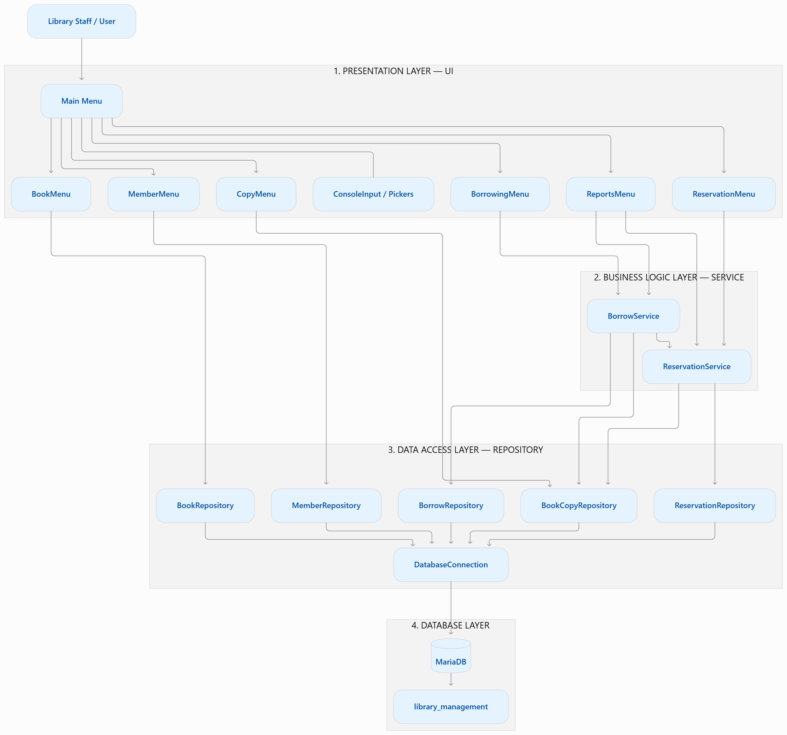

### UML Class Diagram

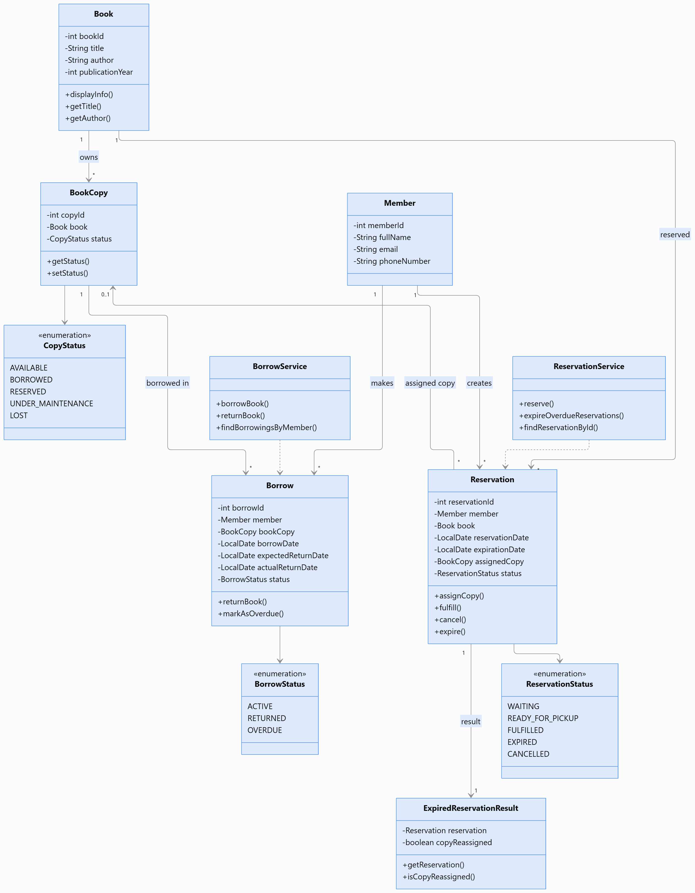

## 📖 Features in Detail

### 1. Book and Copy Management

- Register, update, search, and delete books.
- Manage individual physical book copies.
- Track copy availability through five statuses:
  - `AVAILABLE`
  - `BORROWED`
  - `RESERVED`
  - `UNDER_MAINTENANCE`
  - `LOST`
- Automatically assign available copies to waiting reservations.
- Preserve physical copy records to maintain borrowing and reservation history.

### 2. Member Management

- Register and manage library members.
- Validate member information, including email format and required fields.
- Track each member's borrowing and reservation history.

### 3. Borrowing System

- Borrow and return physical book copies.
- Enforce a maximum of **3 outstanding borrowings per member**.
- Track borrowing dates, expected return dates, and actual return dates.
- Automatically update overdue borrowing statuses.
- Synchronize borrowing records and physical copy statuses with MariaDB.

### 4. Reservation System

- Implement a **First-In, First-Out (FIFO)** reservation queue.
- Automatically assign available copies to the oldest waiting reservation.
- Allow members to cancel reservations.
- Apply a **3-day pickup period** after a copy is assigned.
- Automatically expire overdue pickups.
- Reassign released copies to the next waiting reservation.

### 5. Reports and Statistics

- Display library statistics.
- Show physical copies grouped by status.
- Display overdue borrowings.
- Report expired reservations and copy reassignment results.

## 🗄️ Database Design

The application uses a MariaDB database named `library_management`, containing five tables:

| Table | Description |
|---|---|
| `books` | Stores book information |
| `book_copies` | Stores individual physical copies |
| `members` | Stores library member information |
| `borrows` | Stores borrowing transactions |
| `reservations` | Stores reservation records |

### Entity Relationships

- One book can have multiple physical copies.
- One member can have multiple borrowing records.
- One physical copy can appear in multiple borrowing records over time.
- One member can create multiple reservations.
- One book can have multiple reservations.
- A reservation can optionally have an assigned physical copy.

All tables use primary keys, and relationships are enforced using foreign keys.

### Database ER Diagram

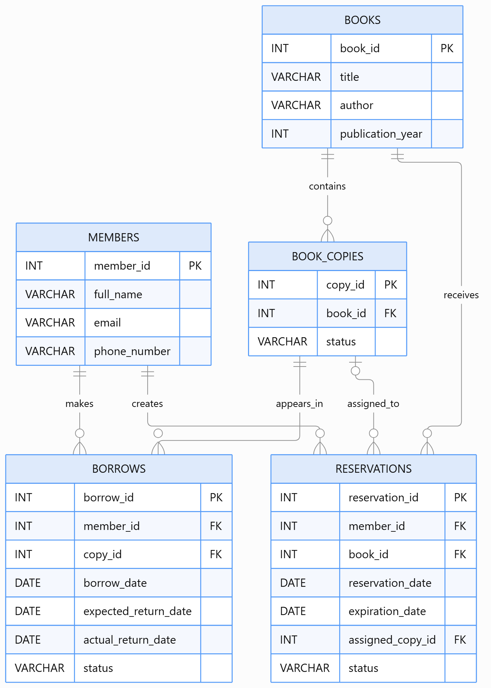

### Database Schema

The SQL schema is available in:

`DATABASE/schema.sql`

## 📋 Core Business Rules

| Rule | Description |
|---|---|
| Borrowing limit | Maximum 3 outstanding borrowings per member |
| Reservation order | FIFO — oldest waiting reservation first |
| Pickup deadline | 3 days after a copy is assigned |
| Reservation collection | Only reservations ready for pickup can be collected |
| Copy allocation | Available copies are automatically assigned to waiting reservations |
| Reservation expiration | Expired reservations release their assigned copies for reassignment |
| Copy history | Physical copy records are retained rather than deleted |

## 🔁 Reservation Lifecycle

A reservation follows this lifecycle:

```text
                  +------------------+
                  |     WAITING      |
                  +------------------+
                           |
                     Copy assigned
                           v
                  +------------------+
                  | READY_FOR_PICKUP |
                  +------------------+
                     |           |
                Collection   Deadline passed
                     |           |
                     v           v
               +-----------+  +-----------+
               | FULFILLED |  |  EXPIRED  |
               +-----------+  +-----------+

       WAITING / READY_FOR_PICKUP ---> CANCELLED
```

## ⚙️ Requirements

Before running the application, make sure you have:

- **JDK 17 or later**
- **MariaDB Server**
- **MariaDB JDBC Driver** (`org.mariadb.jdbc`)
- A Java IDE or command-line environment

## 🔐 Database Configuration

The application connects to MariaDB through:

`com.library.repository.DatabaseConnection`

Adjust the connection credentials if necessary:

```java
private static final String URL =
    "jdbc:mariadb://localhost:3306/library_management?sslMode=disable";

private static final String USER = "root";
private static final String PASSWORD = "";
```

Make sure MariaDB is running and the database schema has been imported before launching the application.

## ▶️ Compilation and Execution

### 1. Clone the repository

```powershell
git clone https://github.com/TatiYassir/LibraryManagementSystem.git
```

### 2. Navigate to the project directory

```powershell
cd LibraryManagementSystem
```

### 3. Create the database

Open MariaDB and execute:

```sql
CREATE DATABASE library_management;
USE library_management;
```

Then import `DATABASE/schema.sql` using your preferred MariaDB client.

### 4. Configure the JDBC driver

Make sure the MariaDB JDBC driver is available in the project's `lib` directory and correctly configured in the module path.

### 5. Compile the project

For Windows PowerShell:

```powershell
$files = Get-ChildItem -Recurse src -Filter *.java |
    ForEach-Object { $_.FullName }

javac -d bin --module-path lib $files
```

### 6. Run the application

```powershell
java --module-path "bin;lib" -m LibraryManagementSystem/com.library.ui.Main
```

> **Note:** The module name, main class, and compilation commands must match the actual `module-info.java` and project configuration. The MariaDB JDBC driver must be accessible through the module path.

## 📸 Screenshots

The following screenshots demonstrate the application's main features.

### Main Menu

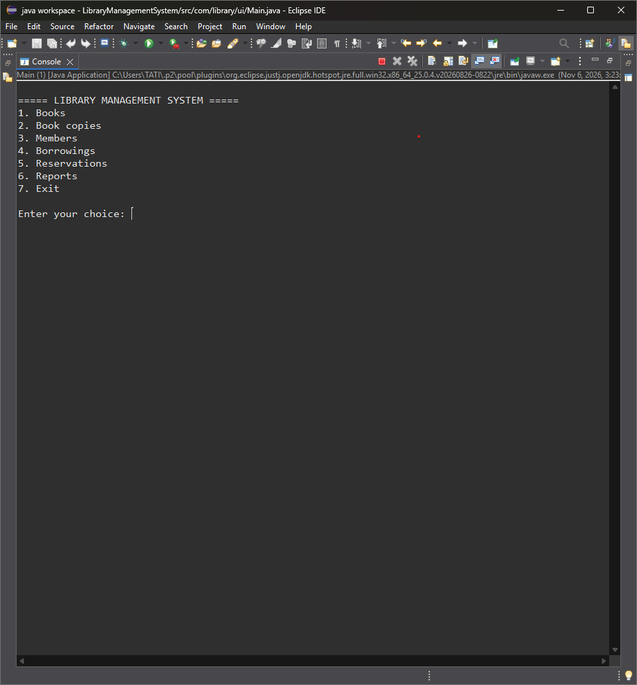

### Book Management

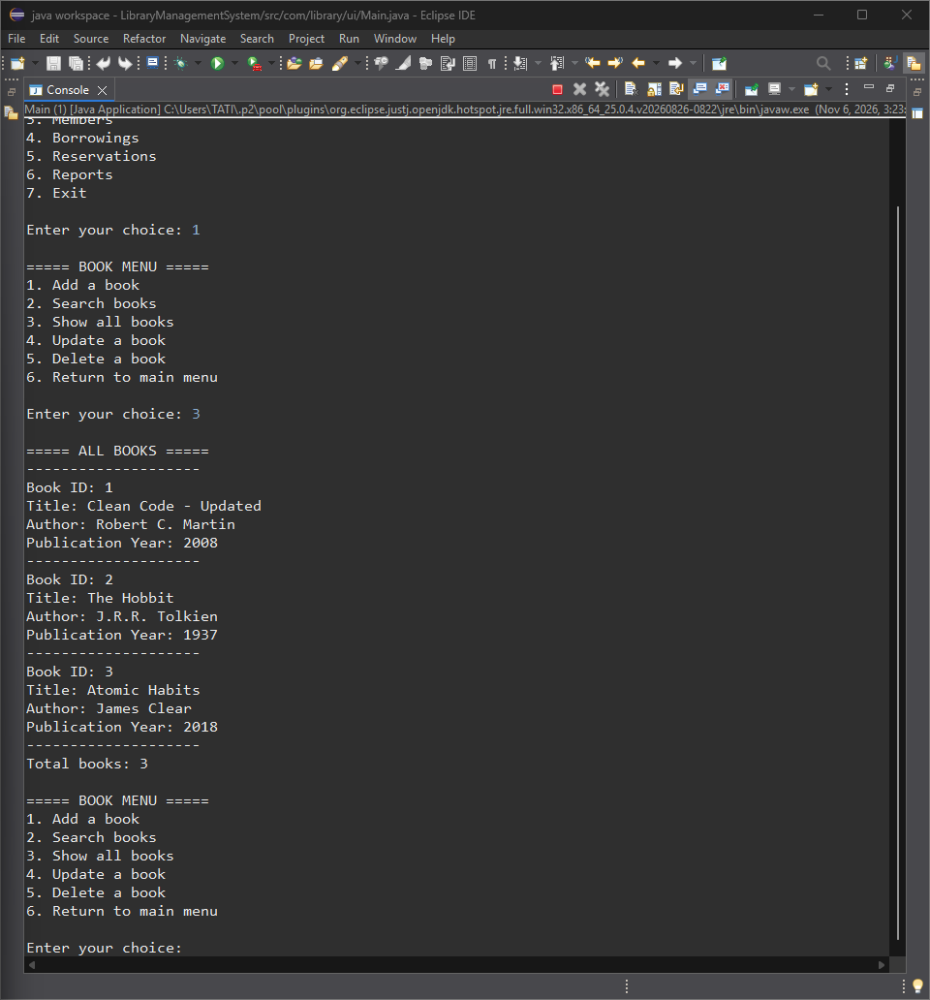

### Physical Book Copies

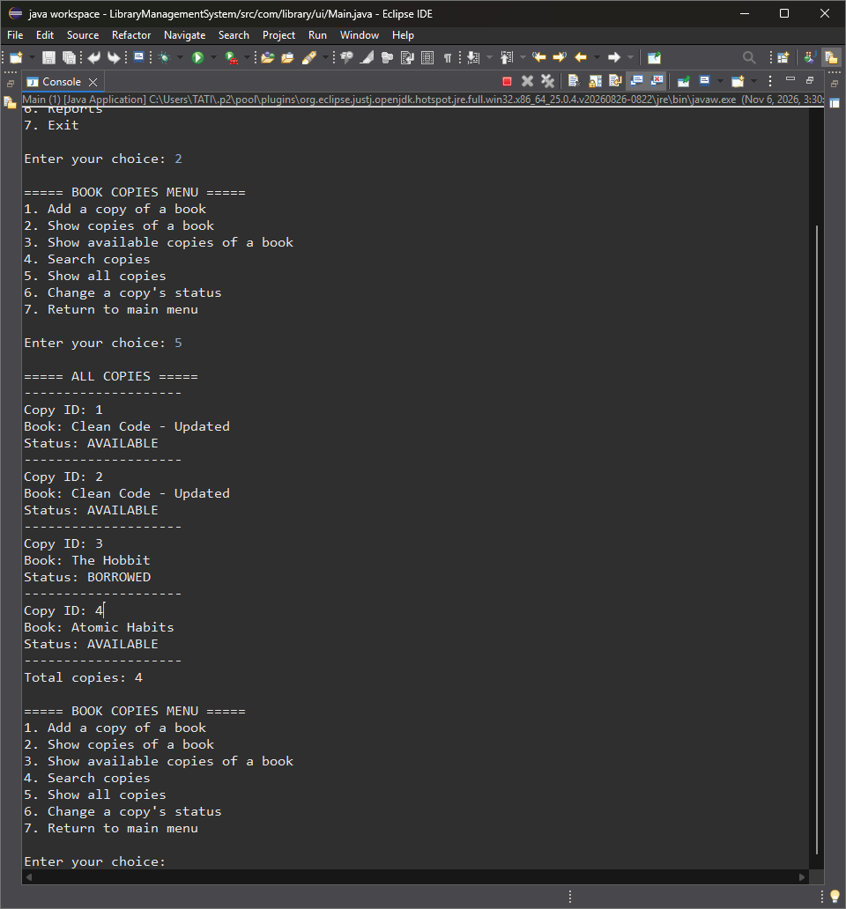

### Borrowing History

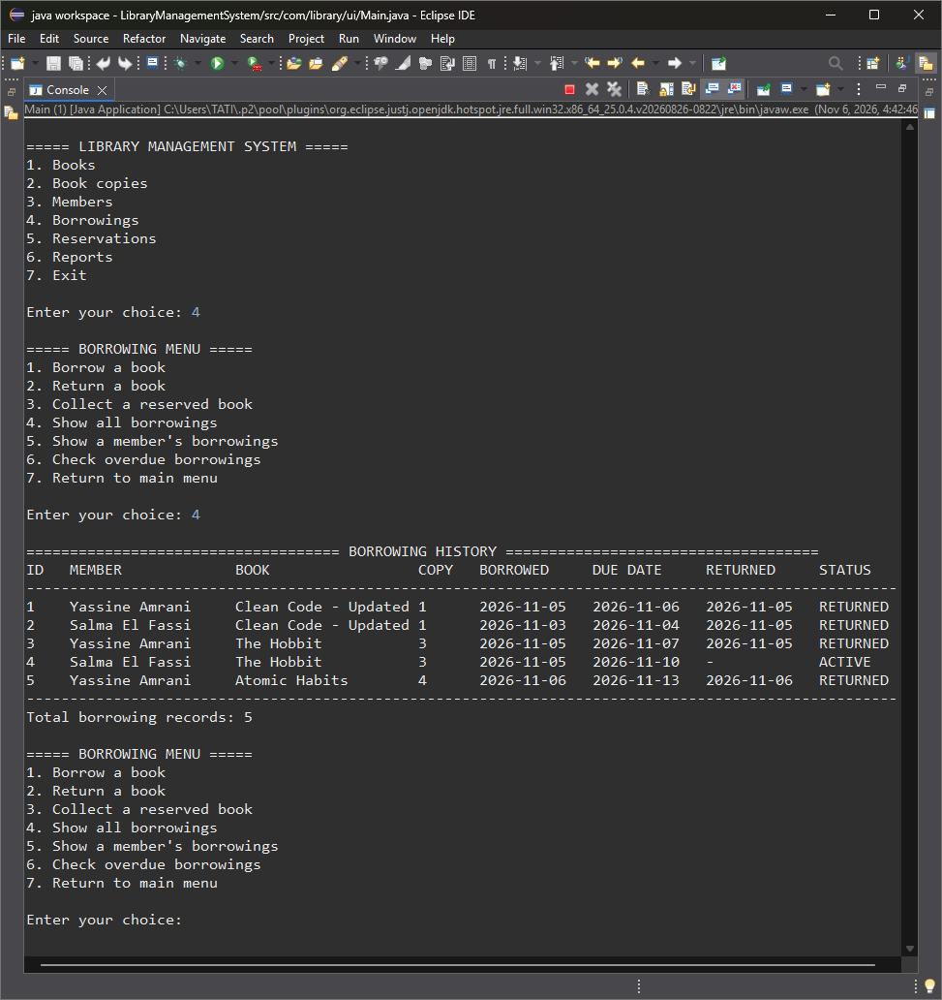

### Successful Borrowing

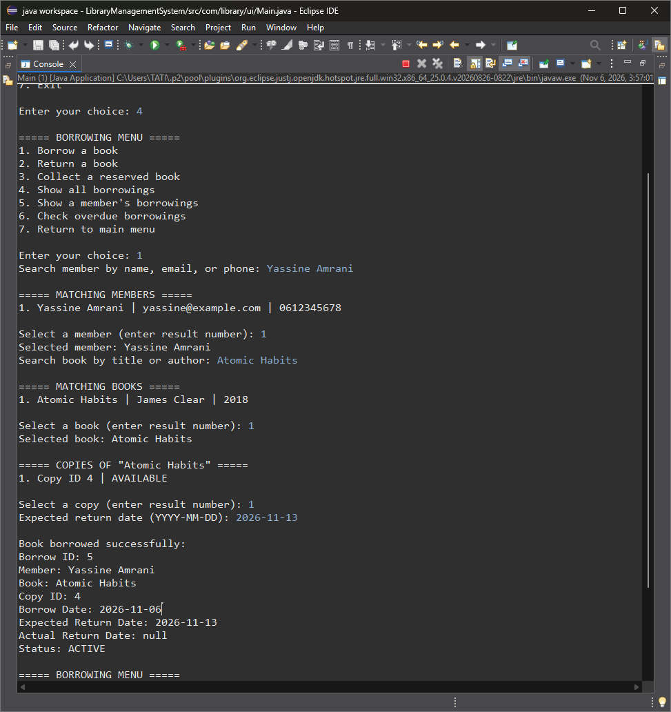

### Successful Return

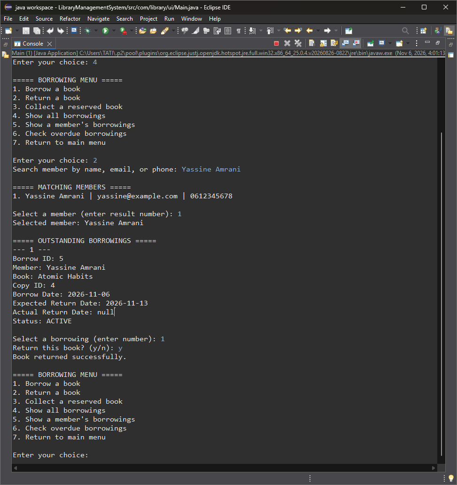

### Reservation History

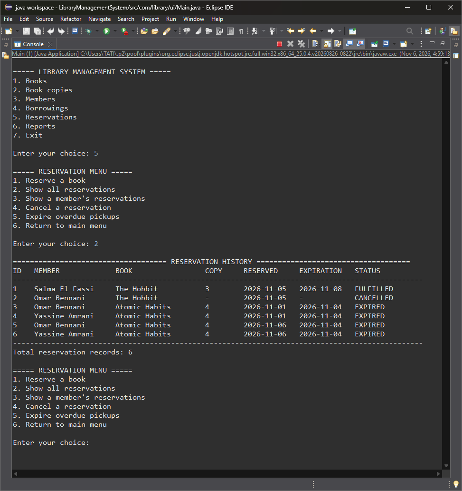

### Library Statistics

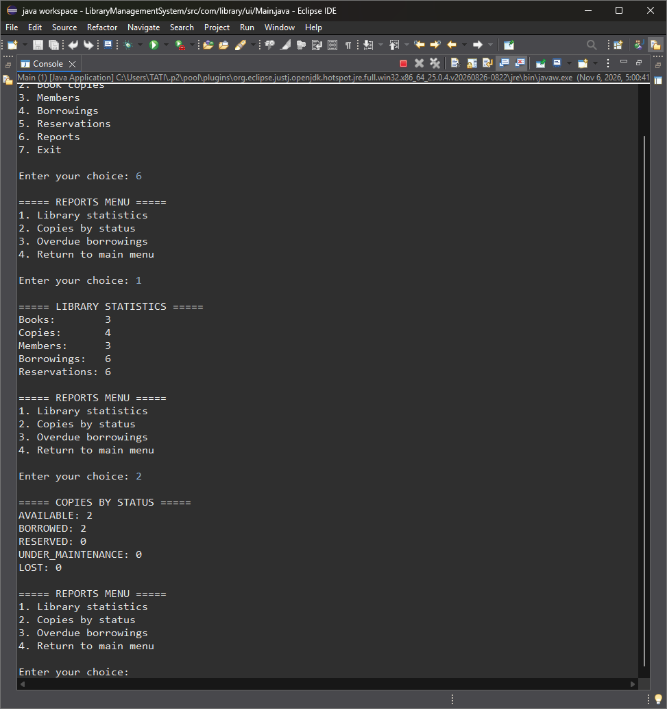

## 🎯 Project Goals

This project was developed to apply and strengthen practical knowledge of:

- Object-Oriented Programming (OOP)
- Java application architecture
- Separation of concerns
- JDBC and relational database integration
- SQL queries and transactions
- Business-rule validation
- Collections and exception handling
- Entity relationships and status management
